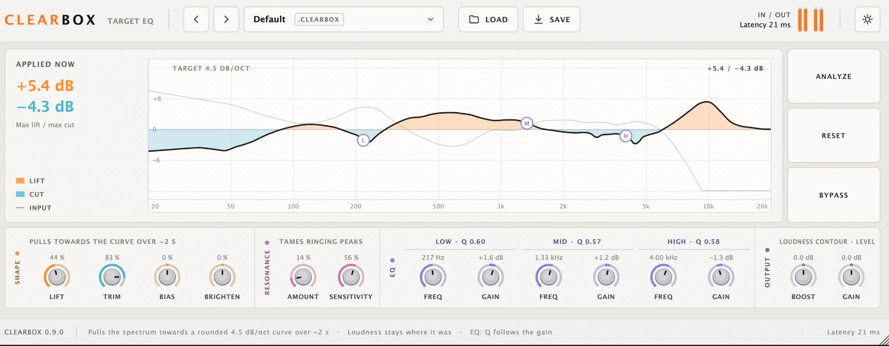
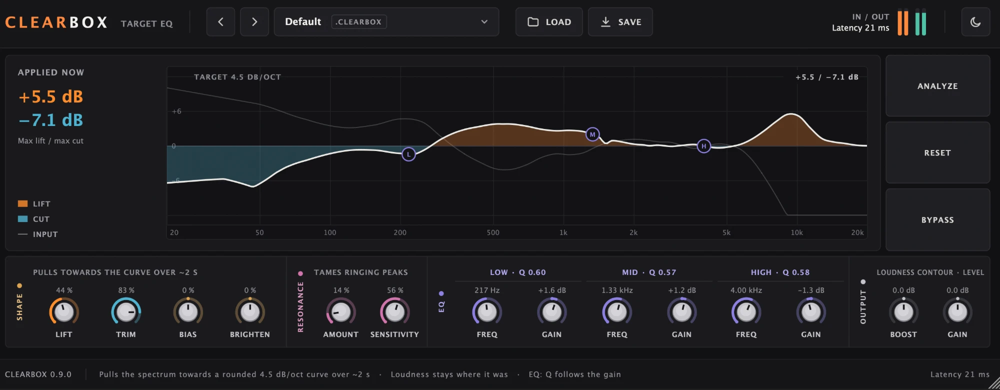

# Clearbox

A target-curve dynamic EQ for macOS: Audio Unit, VST3 and Standalone.

Clearbox measures the spectrum over about two seconds. It then pulls it
towards a rounded 4.5 dB/oct curve: **Lift** raises what lies below the curve
and **Trim** takes off what lies above it. The overall loudness stays where it
was, so switching Bypass compares like with like. Three soft bells follow
after it. They have no Q knob, because their Q follows their gain.

Family: [Kitbox](https://github.com/TZorr/Kitbox), [Tonbox](https://github.com/TZorr/Tonbox), [Rackbox](https://github.com/TZorr/Rackbox), [Rackbox Plus](https://github.com/TZorr/RackboxPlus), [FX Analyzer](https://github.com/TZorr/FXAnalyzer) - whose Target page is Clearbox's analyzer.





## Install

Download `Clearbox.0.9.0.pkg` from
[Releases](https://github.com/TZorr/Clearbox/releases) and run it; choose AU, VST3 or both - they go into `/Library/Audio/Plug-Ins`. Apple Silicon, macOS
26.5 or later. The installer is unsigned, so Gatekeeper refuses it at first:
right-click it and choose Open, or allow it under System Settings › Privacy &
Security.

| Knob | What it does |
| --- | --- |
| Lift | Raises what lies below the curve. 100 % goes all the way up to it, 50 % half way. It does not lift a band far below the threshold of hearing, because that would only raise noise. |
| Trim | Takes off what lies above the curve. 100 % goes all the way down to it. |
| Bias | Above 0 it sets a dead zone, so only larger departures from the curve are treated. |
| Brighten | Tilts the target curve darker or brighter, by up to ±1.5 dB/oct. |
| Resonance: Amount | Tames ringing peaks: narrow resonances that stand out of their neighbourhood are cut within about 0.1 s. At 100 % a peak is flattened into its neighbourhood. |
| Resonance: Sensitivity | How far a peak must stand out to count: 0 % = 12 dB, 100 % = 3 dB. |
| Low / Mid / High Freq and Gain | Three soft bells after the dynamic EQ (see below). |
| Boost | Shapes the balance as it would sound this many dB quieter (+) or louder (−), at the same loudness. It follows the equal-loudness contours and works on its own. |
| Gain | Output level. |
| Analyze | The analyzer: the knobs do nothing and the sound passes untouched. The display shows how far the input is from the curve (see below). |
| Reset | Sets every knob back to its starting position. Bypass and Analyze stay as they are, and the host can undo it. |
| Bypass | Fades to the input, delayed by the latency so nothing jumps. |

The display shows the curve being applied right now: the dynamic correction
and the bells added together, with lift in orange and cut in blue. Behind it,
faintly, is the input in the 4.5 dB/oct view, relative to the target.

Latency is 1024 samples at 44.1/48 kHz (21 ms) and 2048 at 88.2/96 kHz. Both are
reported to the host. With every knob at its start, Clearbox is the input
delayed by the latency, to −136 dB.

## Analyzer

**Analyze** is for matching the curve with something else, for example an
external hardware EQ in front of Clearbox.

- **Signal:** the knobs are greyed out and do nothing. The output is the input,
  delayed by the same latency, bit for bit, so switching never jumps in time.
- **Curve:** the display shows the input's deviation from the pure target
  curve. Above the line is too loud, below is too quiet. Brighten does not
  move it.
- **Octave values:** one dB value per octave from 63 Hz to 16 kHz, rounded to
  0.5 dB, to set an EQ by. An octave the confidence gate counts as missing
  shows a dash instead of a number.
- **Speed and gates:** the measurement is the same as in normal use, with the
  same 2–3 s attack/release per band and the same gates. HOLD in silence
  applies here too.

## The target curve

The target is −4.5 dB/oct (power per Hz), rounded off at both ends. In SPAN Plus
with a 4.5 dB/oct slope it reads as follows:

| Frequency | Level |
| --- | --- |
| 20 Hz | −13 dB |
| 40 Hz | −6 dB |
| 100 Hz | −1 dB |
| 300 Hz – 2 kHz | flat |
| 10 kHz | −4 dB |
| 20 kHz | −12 dB |

Above 14.5 kHz the correction fades out and reaches 0 dB at 18.2 kHz, so air is
never lifted. Below the lowest analysis band (about 47 Hz) the curve carries on
at half its slope.

## How it measures

1. STFT with sqrt-Hann windows and four-fold overlap. The band gains are
   interpolated smoothly to every bin, so the filter does not ring.
2. One band per ERB (Glasberg & Moore). A full-scale sine is calibrated as
   94 dB SPL.
3. Each band's level per Hz is power-averaged over 0.2 s and then in dB with an
   attack and a release per band. A rise is followed in half the time a fall
   is, so something that gets too loud is trimmed promptly and a gap is filled
   only slowly. The bass is averaged longer than the top: the release is 3 s
   at 50 Hz and 1.5 s at 10 kHz. The result is seen with a 4.5 dB/oct slope
   and compared with the curve per octave.
4. **Global gate:** below about −55 dBFS (silence, reverb tails) the
   measurement and the curve hold, and the display shows HOLD. When the music
   comes back it meets the curve it left.
5. **Confidence gate**, between the deviation and the gain: a band more than
   12 dB below the curve fades out of the reference and out of Lift's reach,
   and from 24 dB below it counts as missing. A passage without bass is left
   without bass. It is not filled with noise, and the empty bass does not make
   the rest look too loud. Trim is not gated: what is there and too loud may
   still be cut.
6. A band's distance to the curve, less Bias's dead zone, times Lift or Trim,
   is its correction. The threshold in quiet (Terhardt) keeps Lift off bands
   too quiet to hear.
7. One loudness offset (Zwicker's loudness) keeps the total loudness unchanged.
   It follows at the same 2 s, so a sudden change of spectrum does not
   overshoot.
8. The applied gains glide over 30–40 ms against zipper noise. Both channels
   share one curve.

## Resonance

The target curve works over seconds and on the broad balance. **Resonance**
works in tens of milliseconds on narrow, ringing peaks.

1. **Analysis.** It has its own analyses, longer than the main STFT, so the
   latency stays at 21 ms:
   - from 200 Hz up, 4096 points (11.7 Hz apart), averaged over about 60 ms;
   - from 30 to 400 Hz, 8192 points (5.9 Hz apart), averaged over about
     150 ms.
2. **What counts as a peak.** A peak is measured against the mean power of
   its neighbourhood over ±⅓ octave, leaving out its own ±1/12 octave. This
   is in dB and independent of level, so plain noise rings nowhere.
3. **The notch.** It is as wide as the resonance, measured at half its
   height. It cuts in within about 10 ms and lets go over about 150 ms.
4. **Where the cut goes.**
   - Above about 300 Hz it goes into the STFT's bins.
   - In the bass the STFT is too coarse, so up to three real notch filters
     follow the resonances found there.
   - 250–350 Hz cross over.

Measured on pink noise with +15 dB resonances, Resonance 100 %:

| Measurement | Result |
| --- | --- |
| Resonance at 2.5 kHz (Q 20) | −14.4 dB |
| Resonance at 120 Hz (Q 8) | −8.1 dB |
| One octave away | under 0.3 dB change |
| Detection | half the cut within 95 ms |
| Release | half the cut gone after about 0.2 s |

A bass resonance narrower than one analysis bin (about 6 Hz) stands out less
and is found only at higher Sensitivity.

The idea comes from DyERS by Thiago Lobato (AGPL-3.0): find prominent peaks
and lay a Gaussian notch on each. Clearbox implements it independently, and
no code was taken over.

## EQ

Three peak bands come after the dynamic EQ, so Lift and Trim do not work
against them.

| Band | Range | Start |
| --- | --- | --- |
| Low | 30 Hz – 2 kHz | 200 Hz |
| Mid | 150 Hz – 8 kHz | 1 kHz |
| High | 500 Hz – 16 kHz | 4 kHz |

Each band is ±12 dB. There is no Q knob: Q follows the gain, by the rule
`Q = 0.5 · 4^(|gain| / 12 dB)`.

| Gain | Q | Width |
| --- | --- | --- |
| 3 dB | 0.71 | about 1.9 octaves |
| 6 dB | 1.0 | about 1.4 octaves |
| 12 dB | 2.0 | about 0.7 octaves |

A small move is broad and gentle, a big one is focused, and a cut behaves like
a boost. Changes glide over 20 ms, so turning a knob does not click. At 0 dB a
band does nothing at all.

## Build

```
Scripts/build.sh     # Release build, ClearboxCheck (engine) and EditorShot (processor + panel PNGs)
Scripts/install.sh   # AU + VST3 to ~/Library/Audio/Plug-Ins, app to /Applications, auval
Scripts/package.sh   # builds, runs both checks, and makes the installer in build/
```

This needs JUCE at `~/JUCE` and CMake/Ninja.

Presets are XML `.clearbox` files in `~/Library/Audio/Presets/T'Zorr/Clearbox/`.

## License

AGPL-3.0, see LICENSE. Third-party notices, JUCE among them, are in THIRD_PARTY_NOTICES.md.
